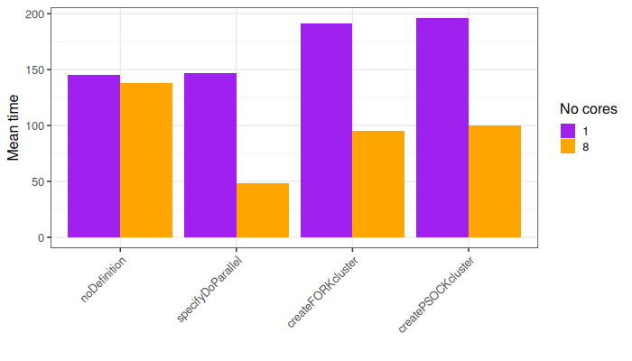

```{r setup, include = FALSE}
knitr::opts_chunk$set(
  collapse = TRUE,
  comment = "#>",
  include = TRUE
)
```


# Introduction

Honeybee simulations consist of simulating individuals as `Pop` classes, and
then on top of this also `Colony` and `MultiColony` classes, all of them with
their meta-data. This makes the simulation computationally demanding and slow.
With the aim to speed up the simulation, we parallelised the major functions
with `future` and `future.apply` R packages. Nothing changed in terms of running
the functions, but to parallelise your simulation, you need to set up a parallel
back-end with the function `plan` from the package `future` before starting the
simulation. You can set that to a desired number or make the simulation use all
available cores. As mentioned in the quick set-up, there are four different
options to the `plan` function: no parallelisation (`sequential`), forking
(`multicore`), PSOCK (`multisession`), and running R processes on multiple
machines (`cluster`). You can read more about these options in the `future`
documentation (<https://cran.r-project.org/web/packages/future/index.html>).
Different options are best suited / viable on different systems.

AlphaSimR, and hence SIMplyBee, also uses another parallelisation concept (OpenMP)
to parallelise when creating new individuals (`SP$nThreads`). In SIMplyBee, creating
individuals it usually not a bottle neck, but rather creating colonies and  `MultiColony`
operations, hence parallelisation with `future` makes more sense. Do note, that the two
parallelisations compete with eachother for core memory, so it's best to limit
one of them to 1 core. If you're creating a small number of colonies with  a lot of individuals,
then use `future::plan(sequential)`, which is the default so you don't have to do anything,
and set `SP$nThreads` to more than one if available. On the other hand, if you plan to 
simulate a lot of colonies, then we recommend you set `SP$nThreads <- 1L`
and use one of the `future::plan()` that parallelises across colonies (see below).


Two mechanisms used by the `future` parallel backends are `FORK` and `PSOCK`.
The forking (`FORK`) creates subprocesses that share memory and objects with the
parent process, which means it's very efficient! However, such parallelisation
is not supported on Windows and usually, also not on HPC clusters. However,
do check with your HPC maintainer if such behaviour is allowed.

The alternative,`PSOCK`, can be used on all system, but it works by creating a
separate R process for each subprocess (that communicate through sockets),
meaning that the whole environment needs to be copied to each subprocess,
creating a larger memory overhead. (adapted from
<https://cran.r-project.org/web/packages/abn/vignettes/multiprocessing.html>).

# Set-up instructions

Here, we show how you should set-up the parallel back-end on different
environments. These need to be set at the beginning of your simulation.
The default plan `sequential` uses one core and is used by default, so that
one doesn't need to be specified exclusively.
As already mentioned, if running on a local Ubuntu machine, `multicore` is
 the most efficient and quick option. When running on HPC, you will probably need to do with 
 `multisession` option, which splits the work between workers, but does have a 
 setting-up overhead. We hence do not recommend parallelising with low number of colonies 
 (see benchmarking below).

```{r quick_setup, eval=F, echo=T}
library(SIMplyBee)
library(future)
library(parallelly)

# Determine the number of available cores automatically
NWORKERS <- parallelly::availableCores() 

# Choose ONE backend (each plan() call replaces the previous plan)
plan(sequential) # Default: no parallel workers
plan(multicore, workers = NWORKERS) # Forking, where supported - allowed on Ubuntu machines (not on HPC)
plan(multisession, workers = NWORKERS) # Separate local R processes (PSOCK), allowed on HPCs
plan(cluster, workers = c("machine1", "machine2")) # Remote R processes

SP$nThreads <- 1L # Limit OpenMP parallelisation when using future parallel backend
options(future.globals.maxSize = 1024^3) # This should be around third to a half of the worker memory
```

We profiled the following piece of code using different parallelisation options.

```{r defining_testing_function}
create_bee_colonies <- function() {
  apiary <- buildUp(apiary, simParamBee = SP)
  tmp <- split(apiary, p = 0.3, simParamBee = SP)
  apiary <- tmp$remnant
  splits <- tmp$split
  rm(tmp)

  # Create a few virgin queens per colony, since csd homozygous ones are removed
  virginQueens <- createVirginQueens(apiary, nInd = 5, simParamBee = SP)
  hasVQ <- !sapply(virginQueens, FUN = is.null)
  virginQueens <- lapply(virginQueens[hasVQ], FUN = function(pop) pop[1])
  splits <- splits[hasVQ]
  splits <- reQueen(splits, queen = mergePops(virginQueens), simParamBee = SP)
  rm(virginQueens)

  splits <- cross(splits, droneColonies = apiary[seq_len(nDPC)],
                                    nDrones = 15, crossPlan = "create",
                                    simParamBee = SP)

  splits <- buildUp(splits, simParamBee = SP)
  # Summer
  half <- seq_len(floor(nCol / 2))
  tmp <- swarm(apiary[half], simParamBee = SP)
  rm(tmp)
  tmp <- supersede(apiary[-half], simParamBee = SP)
  rm(tmp)
  # Autumn
  apiary <- downsize(apiary, p = 0.5, simParamBee = SP)
}
```

The code above was profiled using either the `sequential` plan with 1 core,
or a `multisession` plan with 4, 8, or 16 cores. The runtimes were benchmarked against the previous CRAN version
of the SIMplyBee 0.4.1. All options were tested on an HPC cluster with SGE scheduler.

You can see that the current version 0.5.0 is significantly faster than the 0.4.1 version, which
is due to code optimisation that has nothing to do with parallelisation.
Additional benefit comes from parallelising the code, but the pay-off is larger with
increasing the number of colonies. As explained above, this is due to the overhead time
for setting up a parallele back-end that is independent of the number of colonies.
With small number of colonies, this overhead time is large compared to the running time,
while when the number of colonies increase, the overhead proportion decreases.


```{r time_memory_optimisation, echo=FALSE, out.width='100%'}
#
```

